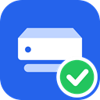
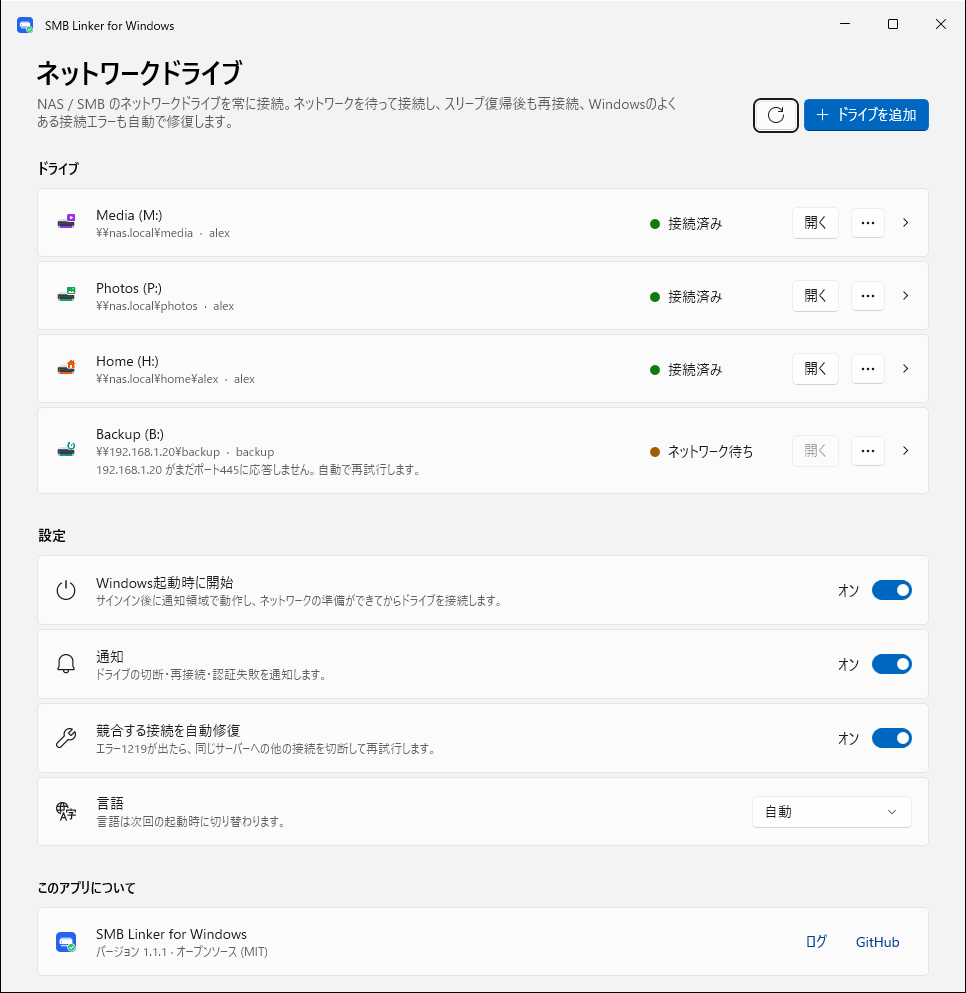
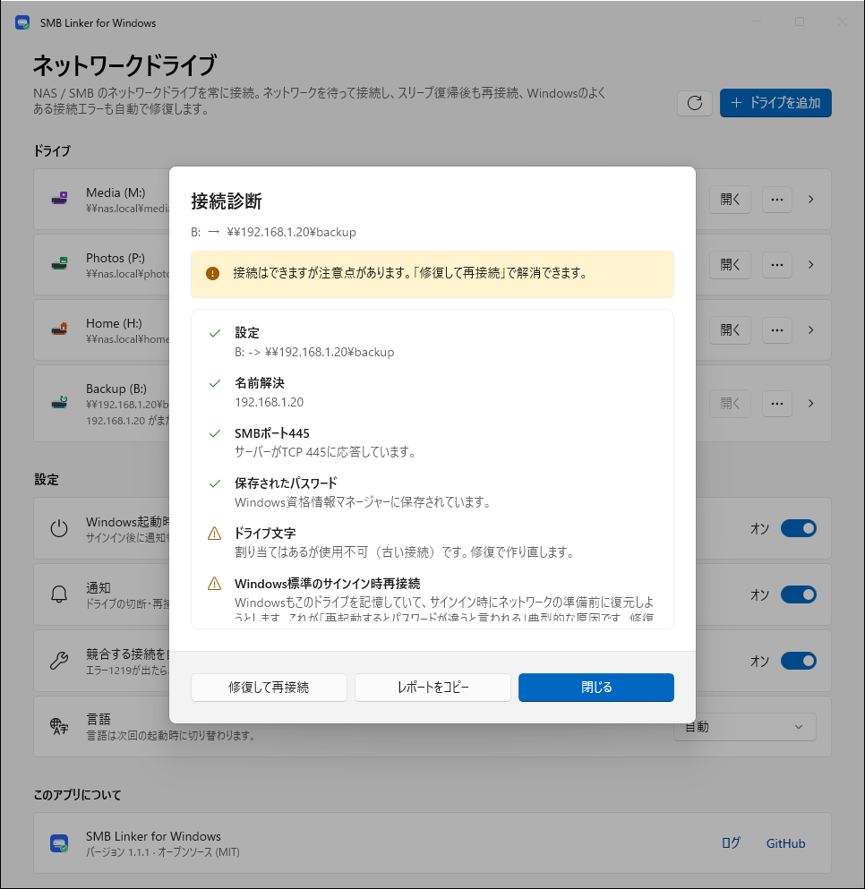
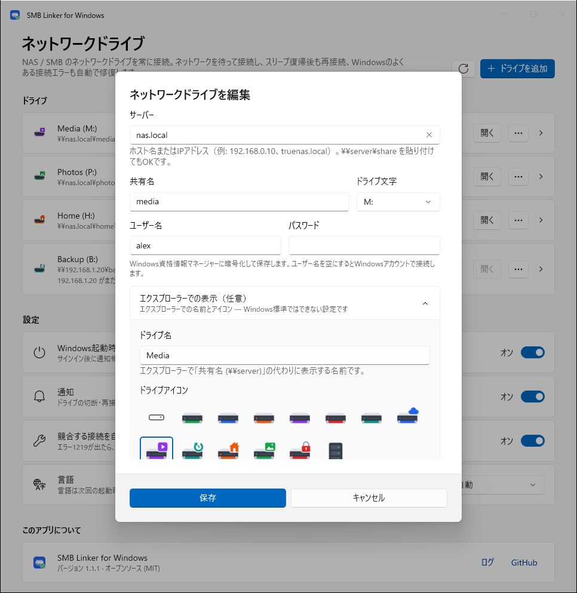
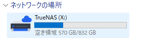
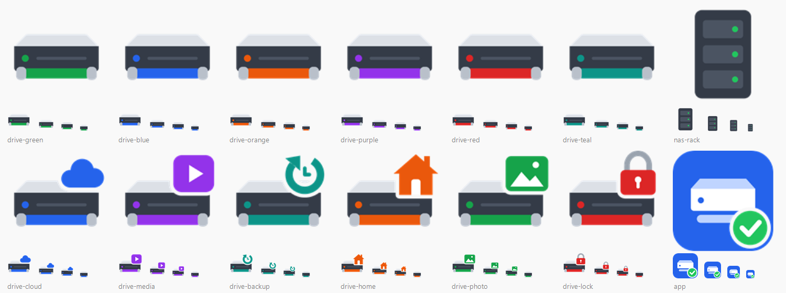

<p align="center">
  
</p>

<h1 align="center">SMB Linker for Windows</h1>

<p align="center">
  <b>NASのドライブを、いつでもそこに。</b><br>
  再起動しても、スリープから復帰しても、ネットワークが切り替わっても。<br>
  Windows 10 / 11 で NAS・SMB のネットワークドライブを確実につなぎ続けるアプリです。
</p>

<p align="center">
  <a href="https://github.com/aruiki/SMB-Linker-for-Windows/releases/latest"></a>
  
  
  <a href="LICENSE"></a>
</p>

<p align="center">
  <a href="README.md">English</a> · 日本語
</p>

<p align="center">
  <picture>
    <source media="(prefers-color-scheme: dark)" srcset="docs/screenshots/ja-main-dark.png">
    
  </picture>
</p>

---

## こんな経験はありませんか？

PCを再起動すると、NASのドライブに赤い ✖ が付いている。開こうとすると **「パスワードが正しくありません」** —— でもパスワードは合っている。あるいは **エラー1219**「同じユーザーによる、サーバーまたは共有リソースへの複数のユーザー名での複数の接続は許可されません」。パスワードを入れ直せばつながるのに、次に再起動するとまた同じことの繰り返し……。

原因は、Windows標準の **「サインイン時に再接続する」** です。**ネットワークの準備ができる前に** ドライブを復元しようとして失敗し、壊れた接続を残してしまうのです。

**SMB Linker はこの問題を根本から解決します。** NAS が本当に応答するのを確かめてから接続します。毎回、確実に。

## 主な特長

### 🔌 ネットワークの準備ができてから接続
SMB Linker はサーバーが SMB のポート（TCP 445）に応答することを確認してからドライブを割り当て、Windows の不安定な「サインイン時の再接続」を置き換えます。次のタイミングで自動的に再接続します。

- サインイン時・スリープからの復帰時・画面ロックの解除時
- Wi-Fi・有線・VPN の切り替え時
- NAS の再起動後（1分ごとに状態を確認）

すでに Windows で割り当て済みのドライブも、そのまま引き継げます。設定し直す必要はありません。

### 🩺 ワンクリックで診断・修復
つながらないとき、**何が** 起きていて **なぜ** なのかを、わかりやすい言葉で示し、そのまま修復できます。

<p align="center"></p>

名前解決、SMB ポート、保存したパスワード、ドライブ文字、「使用不可」になった古い割り当て、Windows 標準の再接続との競合、別ユーザー名の接続を順に確認し、最後に実際の認証テストを行います。**エラー1219 は自動で修復**（別のユーザー名で接続している分だけを切断）。不具合報告用にレポートをコピーでき、パスワードは含まれません。

### 🎨 エクスプローラーでの見た目を自由に
ドライブごとに、エクスプローラーでの **名前とアイコン** を設定できます。**Windows 標準にはない機能** です。「media (\\\\nas.local)」ではなく、選んだアイコンと **「Media」** という名前で表示されます。

<p align="center"></p>

設定すると、エクスプローラーにはこのように表示されます（実際の画面）。Windows 標準の「共有名 (\\\\server)」ではなく、**TrueNAS** という名前とクラウドのドライブアイコンで表示されています。

<p align="center"></p>

Windows 11 になじむフラットなアイコンを 13 種類内蔵。自分の `.ico` も使えます。

<p align="center"></p>

### 🪟 Windows の一部のような使い心地
**WinUI 3** で作られ、Mica 素材・設定アプリと同じカード・ライト/ダークテーマなど、Windows 11 の「設定」と同じ部品で構成しています。普段は通知領域で静かに動き、ドライブの切断・再接続・認証失敗のときだけお知らせします。日本語・英語に対応。

## セキュリティとプライバシー

NAS には大切なファイルがあります。SMB Linker は「安全で、余計なことをしない」ことを第一に作られています。

| | |
|---|---|
| 🔐 **パスワードは Windows の中だけ** | **Windows 資格情報マネージャー** にのみ保存し、Windows アカウントに紐づいて暗号化（DPAPI）されます。設定ファイル・ログ・診断レポートには一切書きません。 |
| 👤 **常に通常ユーザー権限** | インストールにも実行にも管理者権限は不要。常駐サービスも UAC の確認もありません。変更するのはユーザー単位の設定（`HKCU`）だけです。 |
| 🚫 **テレメトリなし** | SMB Linker はどこにもデータを送りません。通信するのは、あなたが登録したサーバーだけです。 |
| 🔒 **アカウントロックを防止** | 拒否されたパスワードで自動再試行はしません。代わりに入力し直しをお願いします。 |
| 🧹 **きれいに消せる** | アンインストールすると、ドライブの切断、保存したパスワード・エクスプローラーの設定・自動起動の削除まで行います。 |
| 📖 **オープンソース** | すべてのコードを MIT ライセンスで公開。配布しているインストーラーは、このリポジトリから GitHub Actions でビルドしています。 |

## Windows 標準との比較

| | Windows「サインイン時に再接続する」 | SMB Linker |
|---|:---:|:---:|
| ネットワークの準備を待ってから接続 | ❌ | ✅ |
| スリープ復帰・ネットワーク切り替え後に再接続 | ❌ | ✅ |
| つながらない理由を表示 | ❌ | ✅ |
| エラー1219 の修復 | ❌ | ✅ |
| エクスプローラーでのドライブ名・アイコン変更 | ❌ | ✅ |
| 切断・再接続の通知 | ❌ | ✅ |

## インストール

1. [Releases](https://github.com/aruiki/SMB-Linker-for-Windows/releases/latest) から **`SMBLinker-Setup-x.y.z-x64.exe`**（ARM 版は `-arm64`）をダウンロードします。
2. 実行します。管理者権限は不要です。
3. **「ドライブを追加」** でサーバー（`\\server\share` の貼り付けも可）、ユーザー名、パスワードを入力し、**「接続テスト」** → **「保存」**。

これだけです。以後は Windows の起動とともに動き、ドライブを接続し続けます。

> **動作環境:** Windows 10（1809 以降）または Windows 11 ・ x64 / ARM64 ・ TrueNAS、Synology、QNAP、Samba、Windows の共有フォルダなど SMB に対応したすべてのサーバー
>
> インストーラーはまだコード署名していないため、「Windows によって PC が保護されました」と表示されることがあります。**「詳細情報」→「実行」** を選んでください。

## よくある質問

<details>
<summary><b>今あるネットワークドライブの割り当ては、先に外す必要がありますか？</b></summary>

いいえ。同じドライブ文字で SMB Linker に追加すれば、既存の割り当てをそのまま引き継ぎ、そのドライブについては Windows 標準のサインイン時の再接続も止めます。
</details>

<details>
<summary><b>パスワードはどこに保存されますか？</b></summary>

Windows 資格情報マネージャー（コントロールパネル →「資格情報マネージャー」→「Windows 資格情報」→「汎用資格情報」）に `SMBLinker:…` という名前で保存されます。それ以外の場所には保存しません。
</details>

<details>
<summary><b>別のユーザー名ではなく、Windows のアカウントで接続できますか？</b></summary>

できます。ユーザー名を空欄にすると、現在の Windows の資格情報で接続します。
</details>

<details>
<summary><b>SmbAutoMount とは何ですか？</b></summary>

1.1.0 より前の、このアプリの旧名です。1.1.0 以降をインストールすると、登録したドライブ・パスワード・設定を引き継いだまま上書きアップデートされます。
</details>

## 開発者向け

必要なもの: [.NET 10 SDK](https://dotnet.microsoft.com/download)、[Inno Setup 6](https://jrsoftware.org/isinfo.php)（`winget install JRSoftware.InnoSetup`）

```powershell
.\build.ps1                     # 発行＋インストーラー作成（x64）→ dist\
.\build.ps1 -Arch arm64
dotnet build src\SMBLinker -c Debug
```

| ツール | 内容 |
|---|---|
| `tools\make-icons.ps1` | アプリアイコンと内蔵ドライブアイコンをコードから生成 |
| `tools\screenshots.ps1` | アプリの `--demo` モード（サンプルデータのみ）から README のスクリーンショットを撮影 |
| `tools\preview-icons.ps1` | `docs/icons-preview.png` を作成 |

Issue・プルリクエストを歓迎します。

## ライセンス

[MIT](LICENSE) ・ アイコンは本プロジェクトのオリジナル作品で、同じライセンスで提供します。
