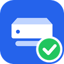
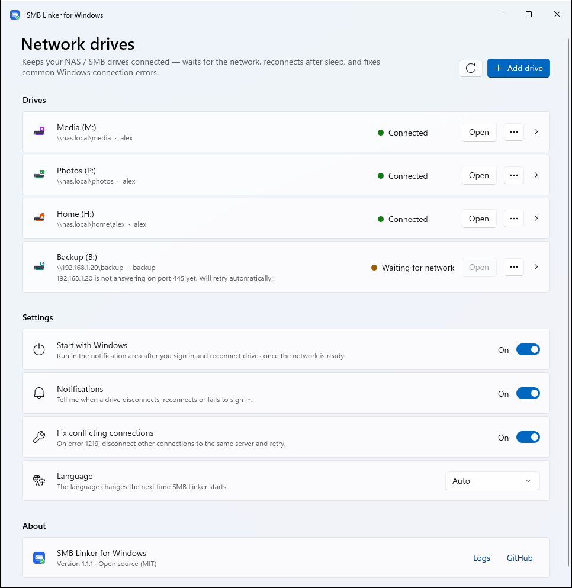
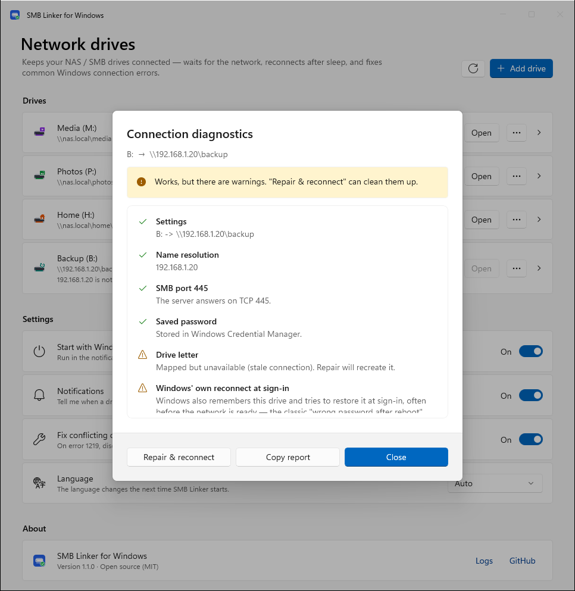
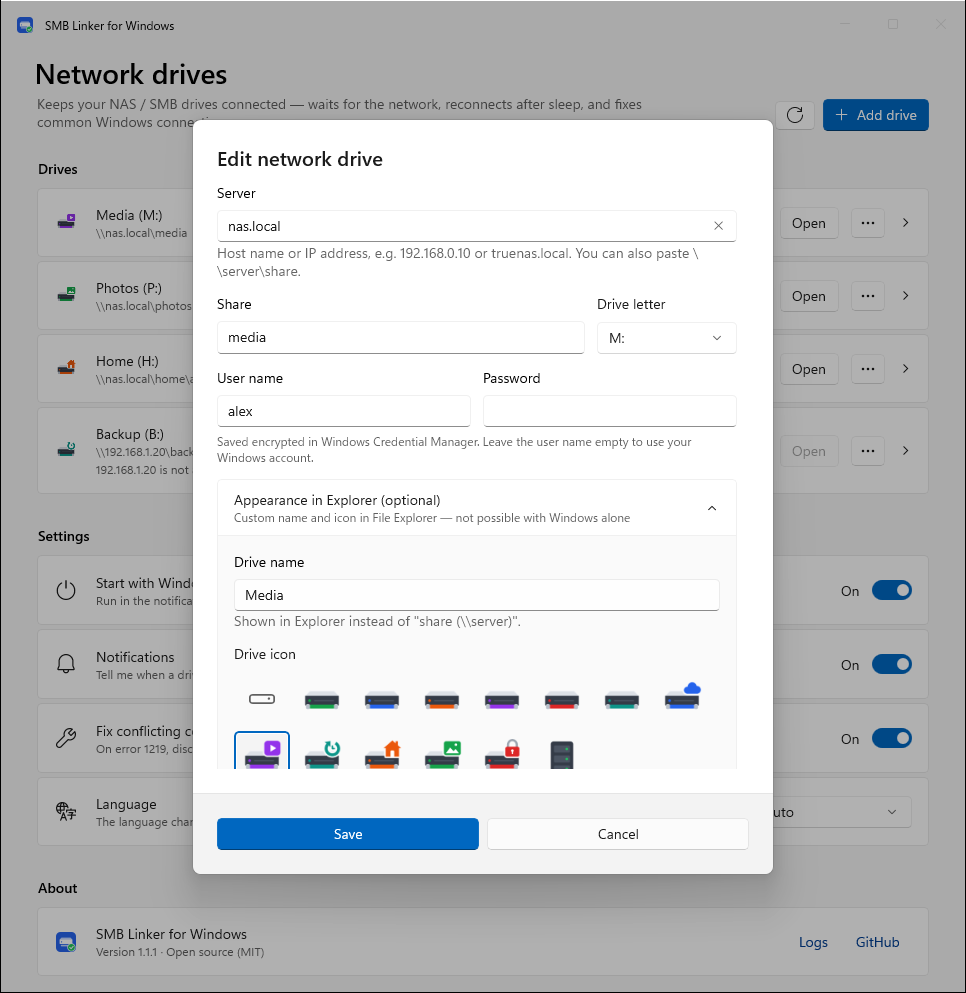
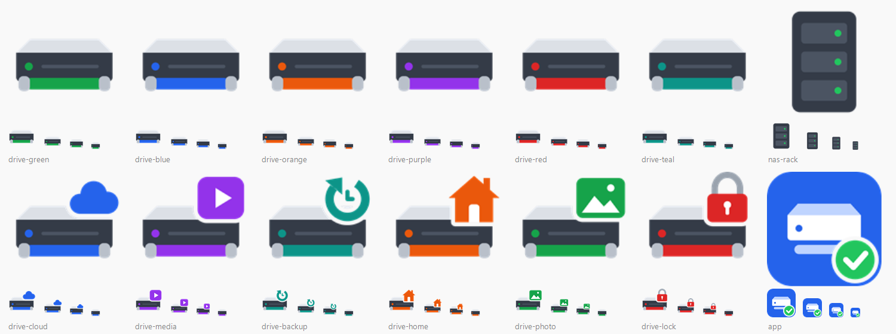

<p align="center">
  
</p>

<h1 align="center">SMB Linker for Windows</h1>

<p align="center">
  <b>Your NAS drives — always there.</b><br>
  Keeps your NAS / SMB network drives connected on Windows 10 and 11,<br>
  after every restart, sleep and network change.
</p>

<p align="center">
  <a href="https://github.com/aruiki/SMB-Linker-for-Windows/releases/latest"></a>
  
  
  <a href="LICENSE"></a>
</p>

<p align="center">
  English · <a href="README.ja.md">日本語</a>
</p>

<p align="center">
  <picture>
    <source media="(prefers-color-scheme: dark)" srcset="docs/screenshots/en-main-dark.png">
    
  </picture>
</p>

---

## Sound familiar?

You restart your PC and your NAS drive has a red ✖. Windows says **"The password is incorrect"** — but it isn't. Or you get **error 1219**: *"Multiple connections to a server by the same user, using more than one user name, are not allowed."* You type the password again, it works… until the next restart.

The cause is Windows' own *"Reconnect at sign-in"*: it tries to restore your drives **before the network is ready**, fails, and leaves a broken connection behind.

**SMB Linker fixes this for good.** It waits until your NAS actually answers, then connects — every time.

## Highlights

### 🔌 Connects when the network is really ready
SMB Linker checks that your server answers on the SMB port (TCP 445) before mapping the drive, and replaces Windows' unreliable sign-in reconnect. It reconnects automatically after:

- signing in, waking from sleep, unlocking the screen
- switching Wi-Fi / Ethernet / VPN
- the NAS rebooting (a health check runs every minute)

Drives that were connected the old way are taken over seamlessly — no need to set them up again.

### 🩺 Diagnose and repair in one click
When something is wrong, SMB Linker tells you **what** and **why** — in plain language — and fixes it.

<p align="center"></p>

It checks name resolution, the SMB port, the saved password, the drive letter, stale "unavailable" mappings, Windows' own racing reconnect, and conflicting sessions — then runs a real sign-in test. **Error 1219 is repaired automatically** by closing only the connections that use a *different* user name. Copy the report for a bug report — it never contains your password.

### 🎨 Your drives, your way — in File Explorer
Give each drive a real name and icon in File Explorer, something **Windows has no setting for**. Instead of *"media (\\\\nas.local)"* you see **Media**, with the icon you picked.

<p align="center"></p>

13 built-in flat icons in the Windows 11 style — or use your own `.ico`:

<p align="center"></p>

### 🪟 Feels like part of Windows
Built with **WinUI 3** — Mica, settings-style cards, light and dark theme, and the same controls as Windows 11 Settings. It lives quietly in the notification area and only speaks up when a drive disconnects, reconnects or fails to sign in. English and Japanese.

## Security & privacy

Your NAS holds your files. SMB Linker is designed to be boring and safe:

| | |
|---|---|
| 🔐 **Passwords stay in Windows** | Stored only in **Windows Credential Manager**, encrypted with your Windows account (DPAPI). Never written to config files, logs or diagnostic reports. |
| 👤 **Runs as you, never as admin** | No administrator rights to install or run, no background service, no UAC prompts. It only changes per-user settings (`HKCU`). |
| 🚫 **No telemetry** | SMB Linker sends nothing anywhere. The only network traffic it creates is to the servers you add. |
| 🔒 **No account lockouts** | A rejected password is never retried automatically — you are asked to fix it instead. |
| 🧹 **Leaves nothing behind** | Uninstalling disconnects the drives and removes saved passwords, Explorer customisations and the startup entry. |
| 📖 **Open source** | Every line is here under the MIT license. Builds are produced by GitHub Actions from this repository. |

## Windows alone vs. SMB Linker

| | Windows "Reconnect at sign-in" | SMB Linker |
|---|:---:|:---:|
| Waits for the network before connecting | ❌ | ✅ |
| Reconnects after sleep / network change | ❌ | ✅ |
| Explains why a drive won't connect | ❌ | ✅ |
| Fixes error 1219 | ❌ | ✅ |
| Custom drive name and icon in Explorer | ❌ | ✅ |
| Notifications on disconnect / reconnect | ❌ | ✅ |

## Install

1. Download **`SMBLinker-Setup-x.y.z-x64.exe`** (or `-arm64`) from [Releases](https://github.com/aruiki/SMB-Linker-for-Windows/releases/latest).
2. Run it — no administrator rights needed.
3. Click **Add drive**, enter the server (you can paste `\\server\share`), your user name and password, press **Test connection**, then **Save**.

That's it. SMB Linker starts with Windows and keeps the drive connected from now on.

> **Requirements:** Windows 10 (1809) or later, or Windows 11 · x64 or ARM64 · works with TrueNAS, Synology, QNAP, Samba, Windows shares and any SMB server.
>
> The installer is not code-signed yet, so Windows SmartScreen may show *"Windows protected your PC"*. Click **More info → Run anyway**.

## FAQ

<details>
<summary><b>Do I have to remove my existing mapped drives first?</b></summary>

No. Add the same drive letter in SMB Linker and it takes over the existing mapping, including removing Windows' own sign-in reconnect for that drive.
</details>

<details>
<summary><b>Where is my password stored?</b></summary>

In Windows Credential Manager (*Control Panel → Credential Manager → Windows Credentials → Generic Credentials*), under `SMBLinker:…`. Nowhere else.
</details>

<details>
<summary><b>Can I use my Windows account instead of a separate user?</b></summary>

Yes — leave the user name empty and Windows sends your current credentials.
</details>

<details>
<summary><b>What happened to SmbAutoMount?</b></summary>

That was this app's name before 1.1.0. Installing 1.1.0 or later upgrades it in place and keeps your drives, passwords and settings.
</details>

## For developers

Requirements: [.NET 10 SDK](https://dotnet.microsoft.com/download) and [Inno Setup 6](https://jrsoftware.org/isinfo.php) (`winget install JRSoftware.InnoSetup`).

```powershell
.\build.ps1                     # publish + installer (x64) -> dist\
.\build.ps1 -Arch arm64
dotnet build src\SMBLinker -c Debug
```

| Tool | What it does |
|---|---|
| `tools\make-icons.ps1` | Generates the app icon and all built-in drive icons from code |
| `tools\screenshots.ps1` | Captures the README screenshots from the app's `--demo` mode (sample data only) |
| `tools\preview-icons.ps1` | Renders `docs/icons-preview.png` |

Issues and pull requests are welcome.

## License

[MIT](LICENSE) · Icons are original artwork included under the same license.
